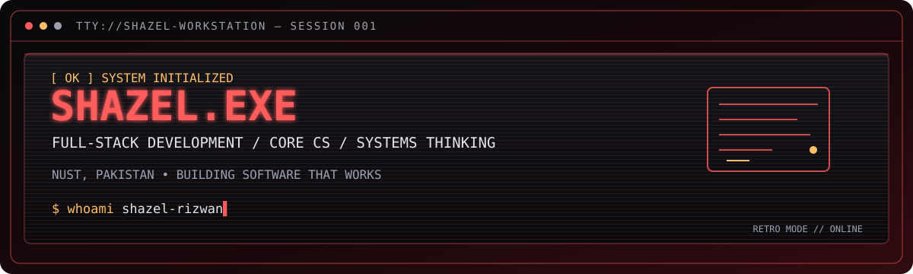
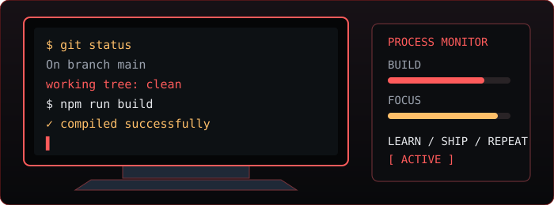

<div align="center">



<p>
  <a href="https://www.shazel-rizwan.live/">PORTFOLIO</a> &nbsp; // &nbsp;
  <a href="https://github.com/ShazelRizwan00">GITHUB</a> &nbsp; // &nbsp;
  <a href="https://www.linkedin.com/in/shazel-rizwan/">LINKEDIN</a> &nbsp; // &nbsp;
  <a href="mailto:shazelrizwan00@gmail.com">CONTACT</a>
</p>

<sub><code>BOOT SEQUENCE COMPLETE // DEVELOPER PROFILE LOADED</code></sub>

</div>

---

## 01 // SYSTEM IDENTITY

I'm **Shazel Rizwan**, a Computer Science student at **NUST, Pakistan**. I build software to turn ideas into working products, with a current focus on full-stack development, practical engineering, and strengthening core CS fundamentals.

```text
USER      shazel-rizwan
ROLE      CS student / developer
BASE      NUST, Pakistan
INTERESTS Full-stack · Product engineering · Core CS
STATUS    LEARN  /  BUILD  /  DEBUG  /  REPEAT
```


## 02 // PROJECT DISPLAY WALL

> Four projects. Different stages. Real work in progress.

<table>
<tr>
<td width="50%" valign="top">

<sub><code>01 // LIVE APPLICATION</code></sub>

### CrewSpace

A team collaboration platform, built around the idea of bringing team workflows into one workspace.

**Status:** Live and presentable

<a href="https://crewspace.runs-on.dev/">OPEN LIVE DEMO ↗</a>

</td>
<td width="50%" valign="top">

<a href="https://pit-lane-zeta.vercel.app/"></a>

### 02 — PitLane

A Formula 1 statistics web app focused on race schedules, standings, and timing classifications.

**Stack:** React · Node.js · Express  
**Status:** Live; some features are still being refined.

<a href="https://pit-lane-zeta.vercel.app/">OPEN LIVE DEMO ↗</a>

</td>
</tr>
<tr>
<td width="50%" valign="top">

<a href="https://www.shazel-rizwan.live/"></a>

### 03 — Personal portfolio

My own corner of the web for presenting projects, technical interests, and what I'm learning.

**Stack:** React · Vite · Tailwind CSS

<a href="https://www.shazel-rizwan.live/">VISIT PORTFOLIO ↗</a>

</td>
<td width="50%" valign="top">

<sub><code>04 // CONCEPT IN DEVELOPMENT</code></sub>

### Cricket Prediction League

A developing concept around cricket predictions, leagues, leaderboards, and match statistics.

**Stage:** Concept / still developing  
**Direction:** Sports data · Predictions · Full-stack

<sub>No live demo claimed; scope and features are still evolving.</sub>

</td>
</tr>
</table>


## 03 // SOFTWARE INVENTORY

<div align="center">


</div>

```text
[ FRONTEND ]   React · JavaScript · TypeScript · Tailwind CSS
[ BACKEND  ]   Node.js · Express · Java · Spring Boot
[ DATA     ]   PostgreSQL · MySQL · Supabase
[ TOOLS    ]   Git · GitHub · Docker · VS Code
[ CORE CS  ]   Data structures · Algorithms · Software engineering
```


## 04 // ACTIVITY MONITOR

<div align="center">


</div>

<sub>Language breakdowns reflect code in public repositories; they are not a measure of skill or proficiency.</sub>

---

<div align="center">



### SESSION ACTIVE // MORE BUILDS IN PROGRESS

`learn(); build(); debug(); repeat();`

<a href="https://www.shazel-rizwan.live/">PORTFOLIO ↗</a> &nbsp; // &nbsp;
<a href="https://github.com/ShazelRizwan00">GITHUB ↗</a> &nbsp; // &nbsp;
<a href="https://www.linkedin.com/in/shazel-rizwan/">LINKEDIN ↗</a> &nbsp; // &nbsp;
<a href="mailto:shazelrizwan00@gmail.com">EMAIL ↗</a>

<br/><br/>


</div>
